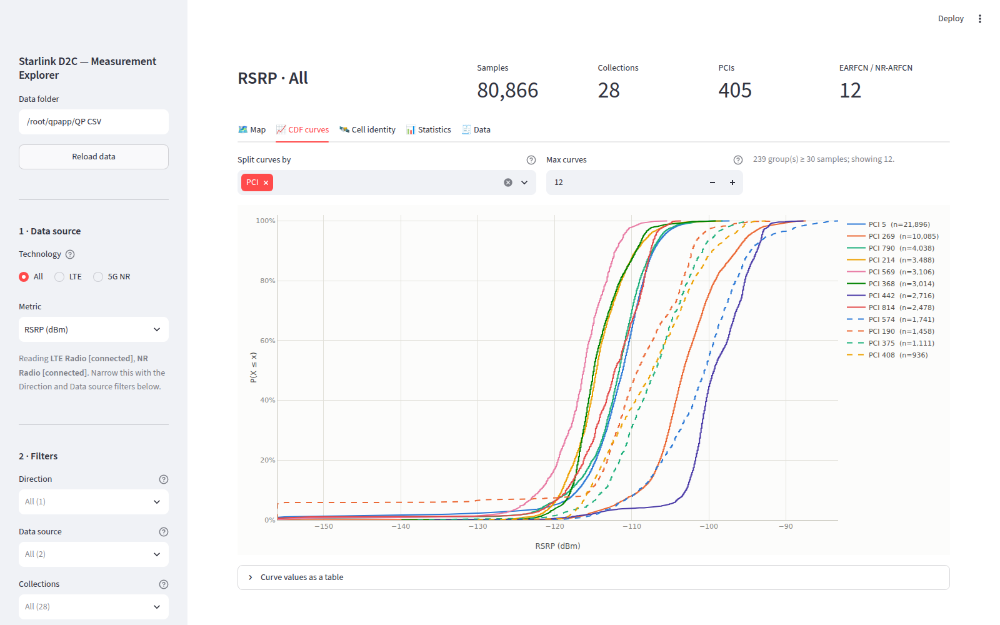

# Starlink D2C — Measurement Explorer

An interactive Streamlit app for exploring Starlink Direct-to-Cell measurement
data from two instruments side by side — **Qualipoc (QP)** connected-mode
drive/walk logs and **PRISM** SDR sweeps. Pick a technology and metric, filter
down to the cells, region, and minutes you care about, and compare them on a
map, as CDF/PDF curves, by which cells were serving and for how long, and
against how many D2C satellites were overhead.



> This README is a **setup guide**. For what each tab does in depth, see the
> [Features](#features) section; for satellite TLEs, see
> [`docs/FETCHING_TLE.md`](docs/FETCHING_TLE.md).

---

## Contents

1. [Prerequisites](#1-prerequisites)
2. [Quick start](#2-quick-start)
3. [The data (already in the repo)](#3-the-data-already-in-the-repo)
4. [Run it](#4-run-it)
5. [Configuration](#5-configuration)
6. [Share it with others (deploy)](#6-share-it-with-others-deploy)
7. [Features](#features)
8. [Project layout](#project-layout)
9. [Tests](#tests)
10. [Troubleshooting](#troubleshooting)

---

## 1. Prerequisites

- **Python 3.10+** (developed on 3.12).
- **git**, and ~200 MB free disk for the repo, its data, and the parquet cache.
- Access to this **private** GitHub repo. The measurement data lives inside it
  (gzipped), so a clone gives you both the code and the data in one step — no
  separate download.

## 2. Quick start

```bash
git clone https://github.com/YuxiChen145/Starlink_D2C.git
cd Starlink_D2C

python3 -m venv .venv
source .venv/bin/activate          # Windows: .venv\Scripts\activate
pip install -r requirements.txt

streamlit run app.py
```

That's it — the clone already contains the data, so the app has something to
show on first run. Streamlit opens `http://localhost:8501`.

## 3. The data (already in the repo)

The measurement CSVs **ship in the repo, gzipped** (`*.csv.gz`, ~13 MB total),
so a fresh `git clone` already has them and the loader reads `.csv` or
`.csv.gz` transparently. The app reads three folders next to `app.py`:

```
Starlink_D2C/
├── QP CSV/       ← Qualipoc exports (the "… - Limited.csv[.gz]" files)
├── PRISM CSV/    ← PRISM SDR scan CSVs (one file per location/carrier)
└── TLE/          ← (optional) Starlink TLEs for satellite visibility
```

- **QP CSV/** — the Qualipoc exports (`LTE Radio [connected] - Limited.csv.gz`,
  `NR PDSCH [per-carrier] - Limited.csv.gz`, …). The app auto-detects which are
  present. Either measurement source alone is enough to run.
- **PRISM CSV/** — the SDR scan files (the collection name comes from the file
  name). PRISM carries signal metrics only and has no GPS in the current
  captures, so it is excluded from the map and satellite tabs.
- **TLE/** — optional; only needed for the **D2C visibility** tab. TLEs are
  *not* committed; fetch them locally — see
  [`docs/FETCHING_TLE.md`](docs/FETCHING_TLE.md).

**Refreshing or adding data — just run `./sync.sh`.** Drop new or updated CSVs
in, then:

```bash
./sync.sh                 # gzips new/changed CSVs, commits, and pushes
./sync.sh "your message"  # ...with your own commit message
```

`sync.sh` re-gzips only what changed, writes a sensible commit message, and
pushes. Run it any time — if nothing changed, it does nothing. Raw `.csv` files
stay local and git-ignored (a local raw file is preferred over its gzip when
both exist).

Two more levels of automation are set up, so you never have to remember:

- **Pre-commit hook** — your normal `git commit` auto-gzips new data first.
  Enable once: `git config core.hooksPath .githooks`.
- **launchd watcher (macOS)** — drop a CSV in a data folder and it pushes
  itself, no command. Install once: `bash scripts/install-autosync.sh`.

See **[`docs/AUTOSYNC.md`](docs/AUTOSYNC.md)** for all three.

> **Why does this run on your Mac, not from Claude?** Pushing to GitHub needs
> *your* GitHub login, which lives in your Mac's keychain — not in a Claude
> session (a session's sandbox has no access to your credentials). So the sync
> runs on your machine, where the login already is.

> **Privacy.** The QP exports carry GPS coordinates. That is why the repo is
> **private** — keep it that way, and share access (or any deploy) only with
> people who should see the measurement locations.

A parquet cache is built under `.cache/qpviz/` on first load and reused after.

## 4. Run it

```bash
streamlit run app.py
```

First load parses the CSVs (a few seconds) and caches them; later loads are
near-instant. Use **Reload data** in the sidebar after replacing a file.

## 5. Configuration

Point the app at data elsewhere with environment variables (all optional):

| Variable | Default | What it is |
|---|---|---|
| `QP_DATA_DIR` | `QP CSV` | Folder of Qualipoc exports |
| `PRISM_DATA_DIR` | `PRISM CSV` | Folder of PRISM scans |
| `TLE_DATA_DIR` | `TLE` | Folder of Starlink TLE files |
| `QP_CACHE_DIR` | `.cache/qpviz` | Parquet cache location |

```bash
QP_DATA_DIR="/data/QP CSV" PRISM_DATA_DIR="/data/PRISM CSV" streamlit run app.py
```

The **QP data folder** and **PRISM data folder** boxes in the sidebar override
these at runtime too.

Optional — satellite visibility needs Starlink TLEs. Fetch the current set with:

```bash
python -m qpviz.satellites fetch TLE
```

and, for the historical campaign dates, pull the Space-Track archive (see the
[TLE guide](docs/FETCHING_TLE.md)).

---

## 6. Share it with others (deploy)

The app is a normal Streamlit server, so anyone with the URL can use it — no
install on their side. Because the data is committed to the (private) repo, any
host that pulls the repo also gets the data — no separate upload step. Pick the
option that fits.

### A. Quick public link — tunnel your local app (easiest)

Run the app locally, then expose that port with a tunnel. Others open the URL;
nothing runs on their machine.

```bash
# terminal 1 — run the app
streamlit run app.py

# terminal 2 — expose port 8501 (pick one)
cloudflared tunnel --url http://localhost:8501      # Cloudflare, no account
ngrok http 8501                                      # ngrok (free account)
```

Great for demos and sharing with a few people. The link lives only while your
app + tunnel are running.

### B. Streamlit Community Cloud (free hosting from GitHub)

At <https://share.streamlit.io>, connect this repo and point at `app.py`. It
builds from `requirements.txt` automatically, and because the data is in the
repo, the deployed app has it — nothing extra to upload. Since the repo is
private, authorize Streamlit's access to it when prompted. Anyone you give the
**app URL** to can use the app; the repo itself stays private.

### C. Self-host with Docker (persistent, your own server)

A `Dockerfile` and `.dockerignore` are included. The image contains the **code
only**; you mount your data at run time, so nothing sensitive is baked into the
image.

```bash
# build once
docker build -t starlink-d2c .

# run — mount a folder that contains "QP CSV", "PRISM CSV" and "TLE"
docker run -p 8501:8501 -v "/absolute/path/to/data:/data" starlink-d2c
```

Then open `http://<server-ip>:8501`. On a cloud VM (EC2, a droplet, your lab
box), put it behind nginx/Caddy for HTTPS and a domain. Best for a stable,
always-on internal site — and keep it access-controlled, since the mounted data
includes GPS.

**Rule of thumb:** share a quick view → **tunnel (A)**; a hosted site straight
from GitHub → **Community Cloud (B)**; a stable, controlled internal site →
**Docker on a server (C)**.

---

## Features

**Two measurement sources, one canvas.** A *Measurement source* filter (QP /
PRISM) pools or isolates them; every other filter is a multi-select where empty
means *all*.

**Filters** — Measurement source, Direction (DL/UL), Data source, Collection,
Band, EARFCN/NR-ARFCN, PCI (union or intersection across collections), a
**region drawn on the map**, and a **time window** (with a per-session jump so
you can isolate a few minutes at a spot).

**Metrics** — RSRP, RSRQ, RSSI, SINR, MCS, Throughput, **Spectral efficiency
(bps/Hz)**, **Throughput per RB (bits/RB)**, BLER, and the **RSRQ N-factor**
(`N = RSRQ·RSSI/RSRP`), wherever the selected exports carry them.

| Tab | What it shows |
|---|---|
| 🗺️ Map | Each sample coloured by the metric, by serving PCI / eNB-gNB / sector (every cell its own colour), or by D2C satellites overhead. |
| 🛰️ D2C visibility | How many Starlink Direct-to-Cell satellites were above the mask at each QP sample — distinct-in-window vs eNB counts, over time, distribution. Needs TLEs. |
| 📈 CDF curves | One ECDF per group on one canvas — or the same groups as a **PDF** (overlaid histograms). CDF / CCDF / PDF toggle. |
| 🛰️ Cell identity | Who is serving you and for how long: dwell timeline, eNB→sector→PCI tree, fan-out statistics. |
| 📊 Statistics | Per-group n / mean / std / percentiles, downloadable. |
| 🧾 Data | The filtered rows, downloadable as CSV. |

Deeper notes on cell identity, the QP↔PRISM differences, satellite visibility,
and how the exports are normalised live in the `qpviz/` module docstrings
(`schema.py`, `loader.py`, `identity.py`, `satellites.py`).

## Project layout

```
app.py               Streamlit UI: filters, tabs, wiring
qpviz/
  schema.py          the exports and their column maps; metric registry
  loader.py          CSV -> canonical frame (QP + PRISM), derived metrics, cache
  filters.py         filter set, point-in-polygon region test, data windows
  identity.py        serving-cell scope, dwell runs, hierarchy, fan-out
  stats.py           ECDF + grouped summary statistics
  charts.py          plotly figures: CDF/PDF, timeline, tree, fan-out, satellites
  mapview.py         folium map, draw control, categorical colouring
  satellites.py      TLE ingest, SGP4 propagation, D2C visibility
  theme.py           colour tokens
docs/                screenshots + TLE and auto-sync guides
tests/               pytest suite (synthetic data; no measurement CSVs needed)
sync.sh              gzip new data, commit, push (see docs/AUTOSYNC.md)
scripts/             auto-sync installer + launchd watcher (macOS)
.githooks/           pre-commit hook: auto-gzip data on commit
Dockerfile           container image for self-hosting
```

## Tests

```bash
pip install -r requirements-dev.txt
pytest
```

The suite builds small synthetic CSVs that reuse the real column names, so it
runs without any measurement data. `tests/test_app.py` executes `app.py`
headlessly; if a real `QP CSV/` folder is present it also smoke-tests against it.

## Troubleshooting

| Symptom | Fix |
|---|---|
| `No QP CSV files found` | Confirm `QP CSV/` has the `*.csv.gz` files (or set `QP_DATA_DIR`); check the sidebar folder box. |
| Satellite tab says *sgp4 not installed* | `pip install -r requirements.txt` (adds `sgp4`), restart. |
| TLE fetch `CERTIFICATE_VERIFY_FAILED` | macOS Python has no CA bundle — the `certifi` dependency fixes it; see the [TLE guide](docs/FETCHING_TLE.md). |
| Stale numbers after replacing a CSV | Click **Reload data**; the parquet cache re-keys on file size/mtime, or delete `.cache/`. |
| Port already in use | `streamlit run app.py --server.port 8502`. |

More: **[docs/FETCHING_TLE.md](docs/FETCHING_TLE.md)** — getting Starlink TLEs
(daily + historical) for the satellite-visibility tab.
